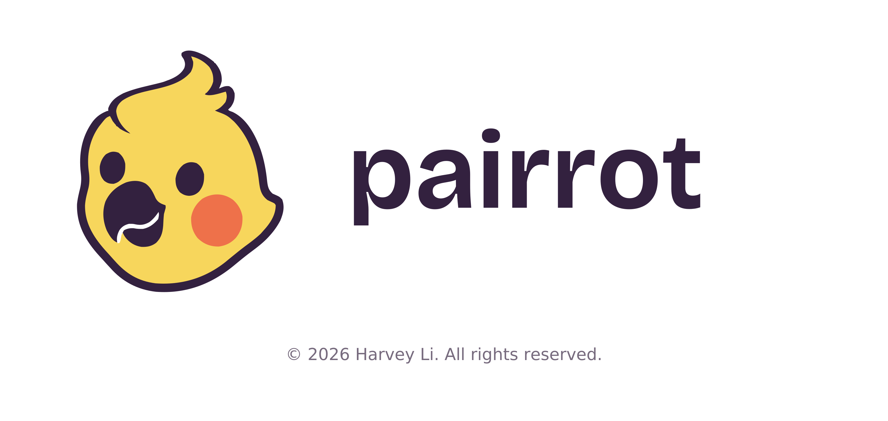
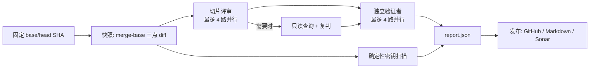

<p align="center">
  
</p>

# pairrot

pairrot 是一个 AI 代码评审引擎：读取一次变更（两个固定的 commit），找出这次变更引入的逻辑错误和错误处理缺失，交给一个独立的验证者复核，只把复核成立的意见写回 PR。

它的取舍很明确：**宁可少报，不要误报；看不全就明说看不全。**

- [设计原理](#设计原理)
- [与 Open Code Review 的对比](#与-open-code-review-的对比)
- [安装](#安装)
- [配置到 CI/CD](#配置到-cicd)（含本地评审指定分支）
- [查看评审结果](#查看评审结果)
- [扩展评审能力和强度](#扩展评审能力和强度)

## 设计原理

### 流程



1. **快照**：评审对象是 `base...head` 的三点 diff（以 merge-base 为起点），两个 SHA 在开始时固定。超过文件数或变更行数阈值的部分不审，并在报告里列为“未审查”，状态记为 `partial`。
2. **评审**：diff 按 32k 字符切片，每片调用一次模型。模型只能报白名单里的类别（默认 `logic_error` 和 `error_handling`），每条发现必须写明触发条件和后果，说不出触发条件的不收。不合格式的候选会被丢弃并记下原因。
3. **查询与复判**（按需）：评审模型觉得看不到调用方或保护条件时，可以请求最多 2 次只读查询（`search_code`、`read_file`、`find_references`、`list_tests`）。拿到结果后，同一个模型再判断一次，只能撤回被证据明确否定的发现，撤回会记录在报告里。
4. **独立验证**：每条候选交给验证者单独复核。验证者看不到评审模型的推理，只看候选本身和一个有大小上限的证据包：
   - `function`：候选所在的整个函数（head 版本）；
   - `diff`：覆盖这个函数的变更行；
   - `callee`：函数里调用的、在本次变更文件中定义的函数和异常类；
   - `caller`：用 `git grep` 在 head 全仓找到的调用点；
   - `lookup`：第 3 步查询的结果。

   每条证据都带来源、版本和是否完整。验证者核对四点：路径能否发生、是否已有保护、是否本次引入、后果有没有说大。结论只有 `confirmed`、`rejected`、`undecided` 三种，只有 `confirmed` 会发到 PR。
5. **密钥扫描**：新增行里的疑似密钥由确定性规则识别，不经过模型。报告和评论里只写变量名，值一律显示为 `[REDACTED]`。
6. **设计轮与简化门禁**（打开 `[compatibility]` 或 `[simplicity]` 时）：契约和简化单独跑一轮评审，和第 2 步并行。这一轮附带一份用 git 算出的事实：签名变化的函数和它们在 head 的调用点、新增函数和类的引用数、与已有函数实现相同的新函数、新增布尔常量的赋值和读取处。验证者拿到同一份事实里与候选文件相关的条目。简化建议进验证者之前，先用确定性规则过一遍：
   - 落在扩展点上的丢弃；
   - 替换代码引入了项目没声明的依赖的直接驳回；
   - 替换代码是一整个函数、标的行号却只覆盖一部分时，范围扩到整个函数；
   - 把替换拼进 head 文件后用 `ast` 解析（只解析，不执行），解析失败，或者删掉的顶层名字在别处仍被使用的，直接驳回；
   - 用 `git grep` 找 head 上提到这个函数的测试文件，作为“锁定测试”。
7. **复杂度统计**：不调模型，从 diff 里数净增行数、新文件、新增类和函数、全仓只用一次的新符号、新增环境变量读取，写进摘要；`[complexity_budget]` 设了上限就按上限把关。

### 原则

- **只读，不执行仓库代码**：所有工具都只读 git 对象，不运行仓库里的脚本，也不访问网络（模型接口除外）。仓库内容在提示词里一律标为数据，不当指令。
- **规则从 base 读取**：`REVIEW.toml` 只从 base commit 读，PR 不能修改用于评审它自己的规则。
- **覆盖面如实上报**：报告写明审了哪些文件、哪些没审及原因、哪些发现未判定、为什么是 `partial`、出了什么错。需求文件和 CI 结果目前只检测是否存在，**不参与审查**，报告里也是这么写的。
- **有预算**：墙钟（默认 600 秒）、费用上限、每个视角的工具调用次数（默认 2 次）都有上限，触顶时状态为 `partial`，剩下的候选记为未判定，不会被静默丢掉。
- **结果可复用**：相同的输入（SHA、提示词版本、模型、规则、预算）会直接复用上一次的报告。中途出过模型错误的运行不会被复用。

## 与 Open Code Review 的对比

[Open Code Review](https://github.com/alibaba/open-code-review)（下称 OCR）是阿里开源的 AI 评审 CLI，也是 pairrot 要替代的对象。

### 设计差异

| | pairrot | Open Code Review |
|---|---|---|
| 评审方式 | 固定流程：切片评审 → 按需查询 → 独立验证 | Agent 式：模型多轮调用工具读代码，最后由 LLM 过滤 |
| 默认范围 | 逻辑错误、错误处理缺失（可在 `REVIEW.toml` 打开安全、性能、跨模块契约、不必要的复杂度） | 更宽，含安全、性能、并发等 |
| 误报控制 | 独立验证者 + 有来源和版本的证据包；证据不足时判未判定 | LLM 后过滤（`--no-filter` 可关） |
| 密钥 | 确定性规则扫描新增行，报告和评论里不出现原值 | 由模型发现 |
| 规则 | `REVIEW.toml`，只从 base 读取 | `rule.json` |
| 输出 | JSON 报告、GitHub 评论、Markdown、Sonar 外部问题 | 文本、JSON、SARIF，自带会话查看器 |

### 实测对比

在 `demo/shop` 样本上做过一次小规模对比。这个样本是一个订单服务，预埋了 21 个缺陷，另有 9 处容易误报的正确代码作为诱饵。三个工具都使用同一个模型（DeepSeek `deepseek-v4-flash`）和默认配置，每个跑 3 次：

| | pairrot（v6） | Open Code Review 1.13.10 | PR-Agent 0.50.0 |
|---|---|---|---|
| 命中预埋缺陷（共 21 个） | 17–18 | 20–21 | 7–9 |
| pairrot 范围内命中（共 15 个） | 14 | 14–15 | 4–6 |
| 误报诱饵（共 9 处） | 0 | 2 | 0 |
| 每轮 token | 5.5–7.4 万 | 48–60 万 | 4–5 万 |
| 每轮耗时 | 80–150 秒 | 87–541 秒 | 82–187 秒 |

另外还单独检验过验证者：给它 6 条故意编造的错误发现，两轮共 12 次全部被驳回。

**怎么理解这组数字：**

- OCR 覆盖面更广、召回更高：pairrot 范围外的竞态、SQL 注入、嵌套循环、时序不安全比较，OCR 基本都能报出来。代价是 token 约为 pairrot 的 7–10 倍，而且每轮都会报 2 个诱饵。
- pairrot 在自己的范围内（逻辑错误、错误处理、密钥）召回接近 OCR，误报为 0，成本低一个数量级。
- **这只是一个试点**：只有一个样本，缺陷和答案由我们自己编写，函数文档里写明了约定（对按约定核对的工具有利），评分也还没有人工复核。正式结论需要更多真实 PR 和盲评。

第二个样本 `demo/ledger` 是一个记账服务，按场景预埋了 29 个缺陷：SQL 注入 4、嵌套循环和隐性平方复杂度 4、时序不安全 4、导致错误的嵌套 3、不可达分支 4、错误处理设计缺陷 6、其他 4（越权、可变默认参数、float 金额、卡号进日志），另有 14 处诱饵和 2 个既有问题。pairrot 在 `REVIEW.toml` 里打开了 `[security]` 和 `[performance]`，其余条件同上，每个工具跑 3 次：

| | pairrot（v9，开安全和性能） | Open Code Review 1.13.10 | PR-Agent 0.50.0 |
|---|---|---|---|
| 命中预埋缺陷（共 29 个） | 26–29 | 28–29 | 7–8 |
| 落到诱饵上的意见 | 0 | 0 | 0 |
| 缺陷以外的意见 | 0 | 5–10 | 未统计 |
| 每轮 token | 10–13 万 | 43–62 万 | 5–5.5 万 |
| 每轮耗时 | 170–220 秒 | 133–253 秒 | 125–161 秒 |

只开默认的正确性视角时，pairrot 每轮命中 18 个，SQL 注入和性能问题为 0；打开两个视角后 token 约增加 50%。三轮里漏掉的主要是 N+1 查询、`==` 比较令牌（验证者以“只有测试调用”驳回过一次），以及偶发的一个嵌套或竞态问题。`[performance]` 默认是 `recommend`，这些意见只进摘要，不挂行内。

第三个样本 `demo/notify` 是一个通知服务，专门测“故意不兼容”和“不必要的复杂度”。它预埋了 14 个缺陷：标准库能替代的手写代码 4 个、多余的重试和原样重抛 2 个、只转发的包装和没人用的别名 3 个、没人传的参数和单实现的策略工厂 2 个、恒为真的开关后面的死分支 1 个、重复实现已有函数 1 个、改了签名但调用方没跟着改 1 个。另有 10 处诱饵：

- 仓库内调用方已同步修改的故意不兼容；
- 仍有旧格式数据要读的兼容代码；
- 换成标准库后行为会变的手写实现（带过期时间的缓存、保留最后出现位置的去重、能处理引号里分号的解析）；
- 声明为扩展点的基类；
- 有人在传的参数；
- 网络调用上的重试。

pairrot 在 base 的 `REVIEW.toml` 里打开了 `[compatibility]` 和 `[simplicity]`，其余条件同上，每个工具跑 3 次。除了数命中，还把每个工具给出的修改建议逐条应用到 demo 的副本上，再跑行为锁定测试和计时，看采纳后会不会坏：

| | pairrot（v11） | Open Code Review 1.13.10 | PR-Agent 0.50.0 |
|---|---|---|---|
| 命中预埋缺陷（共 14 个） | 6–8 | 8–10 | 1–3 |
| 落到诱饵上的意见 | 0 | 2–3 | 1–2 |
| 能直接应用的修改建议 | 每轮 1–4 条，共 7 条 | 每轮 5–9 条，共 23 条（另有 4 条对不上原代码） | 每轮 3 条，共 9 条 |
| 采纳后测试失败或明显变慢 | 0 | 6 | 0 |
| 每轮 token | 10–15 万 | 55–74 万 | 5–7 万 |
| 每轮耗时 | 170–300 秒 | 138–172 秒 | 约 160–180 秒 |

“明显变慢”指比原代码慢 20% 以上，并且多出 3 毫秒以上。诱饵 X07（头部解析）的代码里其实有一个真实 bug：没加引号的值里出现撇号，会吞掉后面的字段。三个工具都报了它，上表没有把这条算作误报。

**怎么理解这组数字：**

- OCR 召回最高，但它的修改建议里有 6 条采纳后会出问题，原因有三类：把带过期时间的缓存换成 `lru_cache`、删掉仍在用的函数或参数、替换代码和原代码行号对不上导致模块导入失败。pairrot 能直接应用的建议更少，但采纳后都没有退化。
- pairrot 漏掉的主要是：手写 memo 缓存（替换时容易丢掉缓存）、给纯函数加重试、给没人写的旧字段留的兜底，以及先判断再建目录。最后一条验证者认为不等价：路径是普通文件时，原代码直接返回，`os.makedirs(exist_ok=True)` 会报错。
- 这一版之前，验证者看不到事实，也不认“仓库内没人用的兼容别名可以删”，每轮只命中 3–5 个；替换代码和行号对不上的建议也会被确认，采纳后有 4 条让模块导入失败。现在这两类问题分别由事实、拼接检查和验证者口径处理。
- 要同时改多处的简化（例如删掉重复实现并把调用点改成已有函数）只作为参考出现在摘要里，不阻断合并。模型有时也会把单处就能完成的简化写成多处改动，这时级别会从 `must_fix` 降为 `recommend`。

## 安装

需要 Python 3.11 或以上、git 2.x，以及一个 OpenAI 兼容的模型接口。

```bash
# 直接安装
pip install "git+https://github.com/iamharvey/pairrot.git"

# 或者从源码安装（开发用）
git clone https://github.com/iamharvey/pairrot.git
cd pairrot
python3 -m venv .venv && .venv/bin/pip install -e ".[dev]"
.venv/bin/python -m pytest -q
```

配置模型。可以写进仓库根目录的 `.env`（已在 `.gitignore` 里，不要提交），也可以直接设环境变量：

```bash
PAIRROT_BASE_URL=https://api.deepseek.com/v1
PAIRROT_API_KEY=sk-...
PAIRROT_MODEL=deepseek-v4-flash
# 可选：验证者换一个模型，默认与评审相同
PAIRROT_VERIFIER_MODEL=
```

`OPENAI_BASE_URL`、`OPENAI_API_KEY`、`OPENAI_MODEL` 也可以，`PAIRROT_*` 优先。

本地评审一次变更：

```bash
pairrot review --repo . --base origin/main --head HEAD --out pairrot-out
# status=passed check=ok report=pairrot-out/report.json reused=false
```

退出码：状态为 `failed`，或者 check 应当失败（`fail_on_must_fix = true` 且确有必须处理的意见，或超出 `[complexity_budget]`）时，返回 1；其他情况返回 0。加 `--defer-check` 时只在运行失败时返回 1。

### 环境变量

| 变量 | 默认 | 含义 |
|---|---|---|
| `PAIRROT_BASE_URL` / `PAIRROT_API_KEY` / `PAIRROT_MODEL` | 无 | 模型接口，必填 |
| `PAIRROT_VERIFIER_MODEL` | 同评审模型 | 验证者用的模型 |
| `PAIRROT_WALL_CLOCK_SECONDS` | 600 | 墙钟上限 |
| `PAIRROT_COST_CAP` | 不限 | 费用上限，也可用 `--cost-cap` |
| `PAIRROT_COST_PER_1K_TOKENS` | 0 | 接口不返回费用时，按这个单价估算 |
| `PAIRROT_MAX_TOOL_CALLS` | 2 | 每个视角最多几次只读查询 |
| `PAIRROT_MAX_FILES` | 40 | 超过的文件不审，记为未审查 |
| `PAIRROT_MAX_CHANGED_LINES` | 2000 | 超过的变更行不审，记为未审查 |
| `PAIRROT_DISABLE_DOTENV` | 无 | 设为 `1` 时不读 `.env`，CI 里建议设置 |

## 配置到 CI/CD

### 本地评审：检查指定分支

不接 CI 也可以在本地评审任意分支。`--base` 和 `--head` 接受分支名、远端分支、tag 或 SHA，pairrot 开始时会把它们解析成固定的 commit。评审范围是 `base...head`：从两者的 merge-base 到 `head` 的变更，和 PR 页面上看到的 diff 一致。

```bash
# 先同步远端，确保 base 是最新的主干
git fetch origin

# 检查 feature/checkout 相对 main 引入的变更
pairrot review --repo . --base origin/main --head feature/checkout --out pairrot-out/checkout

# 检查当前所在分支
pairrot review --repo . --base origin/main --head HEAD --out pairrot-out/current

# 检查另一个仓库里的分支
pairrot review --repo ~/code/shop-service --base origin/release-2.3 --head origin/hotfix/refund --out pairrot-out/hotfix
```

需要注意：

- **只审已提交的内容**。工作区里未提交、未暂存的改动不会被审，要先 commit。不需要切换到被检查的分支。
- 分支要在本地能解析：别人的分支先 `git fetch`，然后用 `origin/<分支名>`。
- `REVIEW.toml` 从 `--base` 一侧读取，所以本地结果和这个分支提 PR 时 CI 的结果一致。
- 每个分支建议用单独的 `--out` 目录。同一目录里，对同一组 commit 重跑会直接复用上次的报告（输出里 `reused=true`）。分支有新提交时，head 变了，会重新评审。
- 结果在 `<out>/report.json`。想在终端或编辑器里读，可以导出成 Markdown：

```bash
pairrot export markdown --report pairrot-out/checkout/report.json --out pairrot-out/checkout/summary.md
```

查看方式见[查看评审结果](#查看评审结果)。

### GitHub Actions

本仓库自带 [`.github/workflows/pairrot-review.yml`](.github/workflows/pairrot-review.yml)，PR 打开或更新时运行。在其他仓库使用时，把 `pip install .` 换成固定版本的安装：

```yaml
name: pairrot review

on:
  pull_request:
    types: [opened, synchronize, reopened, labeled, unlabeled]

permissions:
  contents: read
  pull-requests: write

concurrency:
  group: pairrot-${{ github.event.pull_request.number }}
  cancel-in-progress: true

jobs:
  review:
    # 标签变化只在 pairrot-override 上触发
    if: >-
      (github.event.action != 'labeled' && github.event.action != 'unlabeled')
      || github.event.label.name == 'pairrot-override'
    runs-on: ubuntu-latest
    timeout-minutes: 15
    steps:
      - uses: actions/checkout@v4
        with:
          fetch-depth: 0          # 需要完整历史来算 merge-base

      - uses: actions/setup-python@v5
        with:
          python-version: "3.12"

      - run: pip install "git+https://github.com/iamharvey/pairrot.git@<commit-sha>"

      # 打标签会在同一个 head 上重跑，缓存的报告直接复用，不再调模型
      - uses: actions/cache/restore@v4
        with:
          path: pairrot-out/runs
          key: pairrot-${{ github.event.pull_request.base.sha }}-${{ github.event.pull_request.head.sha }}

      - name: Review
        id: review
        continue-on-error: true
        env:
          PAIRROT_DISABLE_DOTENV: "1"
          PAIRROT_BASE_URL: ${{ secrets.PAIRROT_BASE_URL }}
          PAIRROT_API_KEY: ${{ secrets.PAIRROT_API_KEY }}
          PAIRROT_MODEL: ${{ secrets.PAIRROT_MODEL }}
        run: >
          pairrot review --repo .
          --base ${{ github.event.pull_request.base.sha }}
          --head ${{ github.event.pull_request.head.sha }}
          --out pairrot-out
          --defer-check

      - uses: actions/cache/save@v4
        if: always()
        continue-on-error: true
        with:
          path: pairrot-out/runs
          key: pairrot-${{ github.event.pull_request.base.sha }}-${{ github.event.pull_request.head.sha }}

      - name: Publish
        id: publish
        if: always()
        env:
          PAIRROT_DISABLE_DOTENV: "1"
          GITHUB_TOKEN: ${{ secrets.GITHUB_TOKEN }}
          GITHUB_REPOSITORY: ${{ github.repository }}
        run: >
          pairrot publish github --report pairrot-out/report.json
          --pr ${{ github.event.pull_request.number }}
          ${{ github.event.action == 'synchronize' && '--new-commits' || '' }}

      - name: Fail the check
        if: always()
        run: |
          test "${{ steps.review.outcome }}" = "success" || { echo "评审运行失败"; exit 1; }
          test "${{ steps.publish.outcome }}" = "success" || { echo "发布评论失败"; exit 1; }
          test "${{ steps.publish.outputs.check }}" != "failed" || { echo "存在必须处理的意见"; exit 1; }
```

需要注意：

- 在仓库的 Settings → Secrets and variables → Actions 里添加 `PAIRROT_BASE_URL`、`PAIRROT_API_KEY`、`PAIRROT_MODEL`。
- 触发事件用 `pull_request`，**不要**改成 `pull_request_target`。这样来自 fork 的 PR 拿不到 secrets，评审会失败，而不是在拿到写权限的情况下运行不受信任的代码。
- 评审即使失败也会发布摘要（`continue-on-error` 加 `if: always()`），最后一步再让 check 按实际结果失败。
- `--defer-check` 让评审步骤只在运行失败时返回非零，意见是否挡住合并交给发布步骤判断，因为只有发布步骤能看到 PR 标签。
- **人工放行**：确认是误报时，有写权限的人给 PR 加 `pairrot-override` 标签，check 会在同一个 head 上重跑并通过，摘要里写明是谁放行的，意见照常展示。放行只对当前 head 有效：推新提交时发布步骤会删掉这个标签，需要重新确认。

### GitLab CI

pairrot 还没有 GitLab 发布器。下面的做法是：先评审，再导出一份 Markdown，用 GitLab API 发成 MR 评论，报告作为制品保留。

```yaml
pairrot-review:
  image: python:3.12
  stage: test
  rules:
    - if: $CI_PIPELINE_SOURCE == "merge_request_event"
  variables:
    GIT_DEPTH: "0"                # 需要完整历史来算 merge-base
    PAIRROT_DISABLE_DOTENV: "1"
  script:
    - pip install "git+https://github.com/iamharvey/pairrot.git@<commit-sha>"
    - status=0
    - >
      pairrot review --repo .
      --base "$CI_MERGE_REQUEST_DIFF_BASE_SHA"
      --head "$CI_COMMIT_SHA"
      --out pairrot-out || status=$?
    - pairrot export markdown --report pairrot-out/report.json --out pairrot-out/summary.md
    - >
      python -c 'import json; print(json.dumps({"body": open("pairrot-out/summary.md", encoding="utf-8").read()}))'
      > pairrot-out/note.json
    - >
      curl --fail --silent --show-error
      --header "PRIVATE-TOKEN: $PAIRROT_GITLAB_TOKEN"
      --header "Content-Type: application/json"
      --data @pairrot-out/note.json
      "$CI_API_V4_URL/projects/$CI_PROJECT_ID/merge_requests/$CI_MERGE_REQUEST_IID/notes"
    - exit $status
  artifacts:
    when: always
    paths:
      - pairrot-out/
```

需要注意：

- 在 Settings → CI/CD → Variables 里添加 `PAIRROT_BASE_URL`、`PAIRROT_API_KEY`、`PAIRROT_MODEL`（勾选 Masked），以及 `PAIRROT_GITLAB_TOKEN`：一个有 `api` 权限、角色至少为 Reporter 的项目访问令牌。
- 与 GitHub 版本不同：每次运行都会**新增**一条评论，不会原地更新；意见也不会挂到代码行上，全部列在评论的“意见详情”里。
- 这个配置还没有在真实的 GitLab 实例上验证过。

### SonarQube

`pairrot export sonar` 会把**复核确认的**发现转成 SonarQube 的[通用外部问题格式](https://docs.sonarsource.com/sonarqube-server/latest/analyzing-source-code/importing-external-issues/generic-issue-import-format/)（SonarQube Server 10.3 及以上），在扫描时导入：

```bash
pairrot review --repo . --base "$BASE_SHA" --head "$HEAD_SHA" --out pairrot-out
pairrot export sonar --report pairrot-out/report.json --out pairrot-out/sonar.json

sonar-scanner \
  -Dsonar.projectKey=<your-project> \
  -Dsonar.externalIssuesReportPaths=pairrot-out/sonar.json
```

在 CI 里，把这两步加在现有 Sonar 扫描步骤之前即可（GitHub Actions 和 GitLab CI 都一样）。

导出规则：

- 只导出 `confirmed`，未判定和被驳回的不导出。
- 规则按“类别 + 严重度”生成，例如 `pairrot.logic_error.S1`。S1/S2/S3 对应 `CRITICAL`/`MAJOR`/`MINOR`（MQR 模式下为 `HIGH`/`MEDIUM`/`LOW`）。
- 安全类记为 `VULNERABILITY`，性能类记为 `CODE_SMELL`，其余记为 `BUG`。
- 文件路径相对于仓库根目录，所以 `sonar.projectBaseDir` 应该是仓库根目录（默认就是）。

需要注意：外部问题对应的规则不会出现在 Sonar 的规则页和质量配置里，规则只能在 pairrot 这边管理。这个导入还没有在真实的 SonarQube 实例上验证过。

## 查看评审结果

### 在 GitHub PR 上

每次运行会产生两类内容：

- **行内评论**：挂在变更行上，标题形如 `[S1 逻辑错误] …`，正文写明条件、结果和建议。同一条意见（按指纹识别）不会重复发。
- **摘要评论**：一条以 `pairrot 评审` 开头的评论，之后的运行会原地更新它。内容包括：状态、base/head、已审查和未审查的文件、需求与 CI 覆盖说明、驳回数量、未挂到行内的意见、未判定项、`partial` 原因、错误、耗时和 token。

哪些意见挂到行内，取决于 base 上有没有 `REVIEW.toml`：

| | 有 `REVIEW.toml` | 没有 |
|---|---|---|
| 行内 | `must_fix` 级别的意见 | S1 全部、S2 最多 5 条 |
| 只在摘要里 | `recommend` 级别的意见 | S3，以及超出名额的 S2 |
| check 结果 | `fail_on_must_fix = true` 且存在 `must_fix`，或超出 `[complexity_budget]` 时失败；`pairrot-override` 标签可放行当前 head | 只在运行失败时失败 |

不在本次 diff 可评论行上的意见会放进摘要，并标明原因。

### 看 `report.json`

完整结果都在 `--out` 目录下的 `report.json`，`runs/` 里是可复用的历史报告。主要字段：

| 字段 | 含义 |
|---|---|
| `status` | `passed`、`partial` 或 `failed` |
| `confirmed` / `rejected` / `undecided` | 复核结论，每条带 `verification.reason` |
| `dropped` | 被丢弃的候选及原因，例如格式不合格、类别不在白名单、查询后被撤回 |
| `reviewed` / `unreviewed` | 审了哪些文件，没审的原因 |
| `partial_reasons` / `error` | 为什么是 `partial`，出了什么错 |
| `coverage` | 需求与 CI 是否参与审查 |
| `tokens` / `elapsed_seconds` / `reused` | 用量、耗时、是否复用了旧报告 |
| `fail_check` / `fail_reasons` | check 是否应当失败，以及原因 |
| `complexity` | 复杂度统计和超出的预算项 |

```bash
jq '.confirmed[] | {file: .location.file, line: .location.start_line, title, reason: .verification.reason}' pairrot-out/report.json
jq '.undecided[] | {title, reason: .verification.reason}' pairrot-out/report.json

# 渲染成一份可读的 Markdown
pairrot export markdown --report pairrot-out/report.json --out pairrot-out/summary.md
```

## 扩展评审能力和强度

### 用 `REVIEW.toml` 调整范围和力度

放在仓库根目录，**从 base 读取**，所以修改要合入主干后才对之后的 PR 生效。

```toml
fail_on_must_fix = true          # 有确认的 must_fix 意见时让 check 失败

[correctness]                    # 逻辑错误、错误处理缺失
enabled = true
level = "must_fix"               # must_fix：挂到行内；recommend：只进摘要

[secrets]                        # 确定性密钥扫描
enabled = true
level = "must_fix"

[security]                       # 打开后模型也报安全问题：注入、越权、敏感数据进日志、非恒定时间比较等
enabled = true                   # 需写明攻击者可控的输入和利用路径；硬编码密钥仍归 [secrets]
level = "must_fix"

[performance]                    # 打开后模型也报性能问题（需写明输入规模和后果）
enabled = true
level = "recommend"

[compatibility]                  # 不兼容默认是故意的，只把 stable 里的路径当外部契约
enabled = true                   # 打开后报 contract_break：仓库内还有按旧约定使用的位置，或破坏了稳定接口
level = "must_fix"
stable = ["api/*", "proto/*"]
allow_break = []                 # 要在稳定路径上做一次故意的破坏，先把路径加到这里并合进主干

[simplicity]                     # 不必要的复杂度：必须给出替换代码，并说明行为和性能不变
enabled = true
level = "must_fix"               # 只对有测试锁定的意见生效，没有测试的一律 recommend
extension_points = ["plugins/*"] # 故意留的扩展点，不报“只有一个实现”

[complexity_budget]              # 不调模型的复杂度统计，设了哪项就按哪项把关
max_net_added = 800
max_single_use = 10

[[extra]]                        # 追加给评审模型的团队规则，可以写多条
enabled = true
instruction = "如果新增的外部调用没有超时，报 error_handling，并写明哪个调用会一直挂住。"
```

`[[extra]]` 只能让模型在已开启的类别里多注意某类问题，产出的发现仍然要过类别白名单和独立验证。所以写规则时要说明归到哪个类别，否则会被丢弃。

### 故意不兼容与简化

模型评审容易往两个方向把代码推复杂：建议为旧数据、旧调用方加兼容层，以及接受 AI 生成代码里多余的抽象和兜底。pairrot 对这两件事的处理：

- **不兼容默认是故意的**。无论开不开 `[compatibility]`，评审意见的建议都不会提议兼容层、兜底分支、旧字段别名或双读双写，“没有兼容旧数据”本身也不算缺陷。只有两种情况会报 `contract_break`：改了约定但 head 上仓库里仍有按旧约定使用的位置（验证者要在调用方证据里看到它），或者改动落在 `stable` 列出的路径上。声明只认 base 上的 `REVIEW.toml`，PR 描述里写的不算。
- **简化要能直接采纳**。`[simplicity]` 打开后，每条 `complexity` 意见必须带三样东西：替换后的代码、逐项的行为等价说明（空输入、None、异常类型、顺序、边界值、副作用）、性能说明，缺一样直接丢弃。替换的来源按优先级是标准库、项目已有依赖、仓库里已有的函数、直接删除；不允许为了简化引入新依赖。函数长度、嵌套深度、命名这类没有替换代码的意见仍然不报。
- **要改多处的简化只作参考**。比如删掉重复实现并把调用点改成已有函数，一段替换代码表达不了。这种意见不带替换代码，改为列出每一处要改的位置，固定为 `recommend`，只进摘要，不阻断合并。
- **验证者过三道关**：
  - 等价：任何一种允许的输入行为不同就驳回。只比较仓库里实际存在的调用方式，删掉没人传的参数后，“传了会报 TypeError”不算不等价。
  - 性能：复杂度量级、IO、查询次数不能变差。
  - 删除安全：调用方证据和事实里没有其他使用者，没有反射、字符串注册或 `__all__` 导出。注释写着“给旧调用方用”不算对外导出；不在 `stable` 路径上、仓库内没人用的兼容别名可以删。
- **级别看测试锁定**。pairrot 不运行仓库里的测试，它用 `git grep` 查 head 上有没有测试文件提到这个函数。有就按 `[simplicity].level` 处理，评论里列出这些测试，采纳后由仓库自己的 CI 确认不退化；没有就降为 `recommend`，提示先补测试再简化。能整段替换时评论里是 GitHub 的 suggestion 块，可以一键采纳。

### 调预算

- **查得更深**：调大 `PAIRROT_MAX_TOOL_CALLS`，评审模型可以多做几次只读查询。
- **大 PR**：调大 `PAIRROT_MAX_FILES`、`PAIRROT_MAX_CHANGED_LINES` 和 `PAIRROT_WALL_CLOCK_SECONDS`。否则超出部分会记为未审查，状态为 `partial`。
- **控制成本**：设置 `PAIRROT_COST_CAP`。触顶后剩下的候选记为未判定，不会被丢掉。

### 换模型

评审和验证可以用不同的模型。常见做法是评审用便宜快速的模型，验证者用更强的模型（`PAIRROT_VERIFIER_MODEL`），因为最终发不发意见由验证者决定。

### 改代码

| 想做的事 | 位置 |
|---|---|
| 打开更多类别（如并发、数据一致性） | `src/pairrot/models.py` 的 `Category`、`CORRECTNESS_CATEGORIES`，以及 `policy.py` 的 `llm_categories` |
| 改评审提示词 | `src/pairrot/review.py` 的 `REVIEW_SYSTEM_PROMPT`、`prompt_for` |
| 改验证者的判断标准 | `src/pairrot/verify.py` 的 `VERIFY_SYSTEM_PROMPT` |
| 给验证者更多上下文 | `src/pairrot/context.py`（函数、被调、调用方的选取和行数上限），以及 `verify.py` 的 `VERIFY_PACK_LIMIT` |
| 加只读工具 | `src/pairrot/tools.py` 的 `TOOL_SPECS` 和 `review.py` 的 `_LOOKUP_TOOLS`。工具不能执行仓库代码 |
| 切片大小和并发 | `review.py` 的 `_SLICE_CHARS`、`_PARALLEL` |
| 密钥识别规则 | `src/pairrot/redact.py`、`secrets_scan.py` |
| 新的发布目标 | 参考 `publish_github.py` 和 `export.py` |

改了提示词就要升级 `review.py` 里的 `PROMPT_VERSION`，否则相同输入会复用旧报告。

### 衡量改动的效果

改动之后，用同一批样本重跑并对比，不要只看单次结果，因为同一个模型多次运行的结果会有波动：

```bash
# 导入人工标注的评审记录（数据集 A/B），按约定口径回放
pairrot eval import-audit --xlsx audit.xlsx --out datasets/
pairrot eval replay --dataset datasets/ --repos-root repos/ --out replay-out/
```

重点看三件事：确认的意见里有多少是真问题，真问题漏了多少，`undecided` 和 `partial` 有没有变多。
